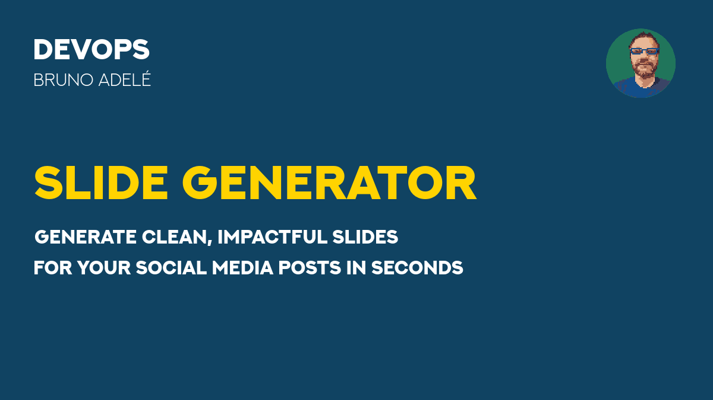
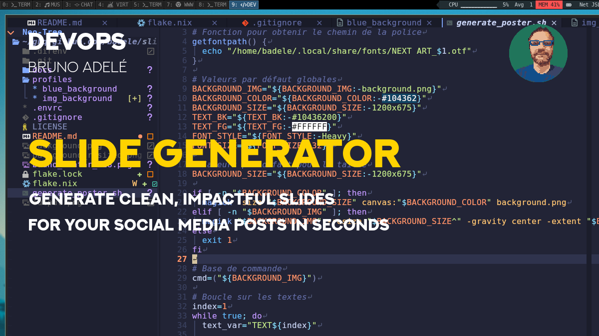
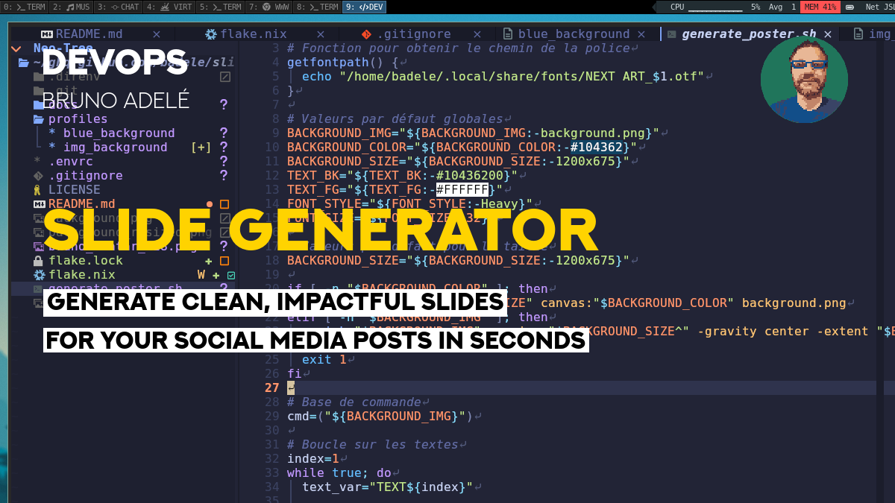
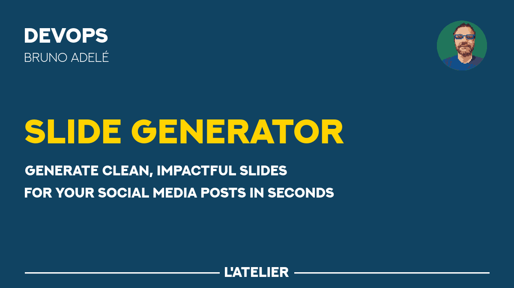

# User post profile

## Blue background



```bash
./generate_slide.sh --profile user_post \
  --set TEXT10="DEVOPS" \
  --set TEXT11="BRUNO ADELÉ" \
  --set TEXT12="SLIDE GENERATOR" \
  --set TEXT13="Generate clean, impactful slides" \
  --set TEXT14="for your social media posts in seconds" \
  --set IMG99="https://raw.githubusercontent.com/badele/slide-generator/refs/heads/main/resources/bruno_avatar_128.png" --set IMG99_GRAVITY="northeast" --set IMG99_GEOMETRY="+58+42"
```

## Custom background image



```bash
./generate_slide.sh --profile user_post \
  --set IMG1="resources/vim_vide_project.png" \
  --set TEXT10="DEVOPS" \
  --set TEXT11="BRUNO ADELÉ" \
  --set TEXT12="SLIDE GENERATOR" \
  --set TEXT13="Generate clean, impactful slides" \
  --set TEXT14="for your social media posts in seconds" \
  --set IMG99="https://raw.githubusercontent.com/badele/slide-generator/refs/heads/main/resources/bruno_avatar_128.png" --set IMG99_GRAVITY="northeast" --set IMG99_GEOMETRY="+58+42"
```



```bash
./generate_slide.sh --profile user_post \
  --set IMG1="resources/vim_vide_project.png" \
  --set TEXT10="DEVOPS" \
  --set TEXT11="BRUNO ADELÉ" \
  --set TEXT12="SLIDE GENERATOR" \
  --set TEXT13="Generate clean, impactful slides" --set TEXT13_BG="#FFFFFF" --set TEXT13_FG="#000000" --set TEXT13_EFFECTS_AFTER="-trim -bordercolor '#FFFFFF' -border 5x5" \
  --set TEXT14="for your social media posts in seconds" --set TEXT14_BG="#FFFFFF" --set TEXT14_FG="#000000" --set TEXT14_EFFECTS_AFTER="-trim -bordercolor '#FFFFFF' -border 5x5" \
  --set IMG99="https://raw.githubusercontent.com/badele/slide-generator/refs/heads/main/resources/bruno_avatar_128.png" --set IMG99_GRAVITY="northeast" --set IMG99_GEOMETRY="+58+42"
```

## With title section



```bash
./generate_slide.sh --profile user_post \
  --set TEXT10="DEVOPS" \
  --set TEXT11="BRUNO ADELÉ" \
  --set TEXT12="SLIDE GENERATOR" \
  --set TEXT13="Generate clean, impactful slides" \
  --set TEXT14="for your social media posts in seconds" \
  --set COMMAND90="-stroke '#FFFFFF' -strokewidth 3 -draw 'line 58,639 1142,639'" \
  --set TEXT91="L'atelier" --set TEXT91_FONT_SIZE=32 --set TEXT91_GRAVITY="north" --set TEXT91_GEOMETRY="+0+626" --set TEXT91_EFFECTS_AFTER="-trim -bordercolor '#104362' -border 12x0" \
  --set IMG99="https://raw.githubusercontent.com/badele/slide-generator/refs/heads/main/resources/bruno_avatar_128.png" --set IMG99_GRAVITY="northeast" --set IMG99_GEOMETRY="+58+42"
```
